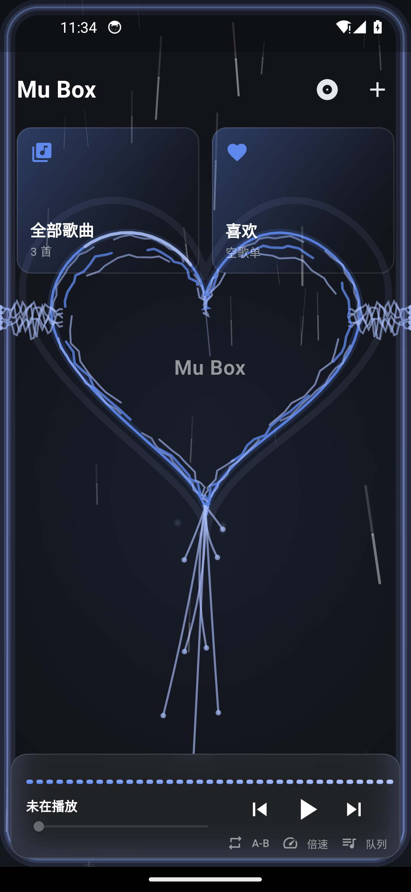
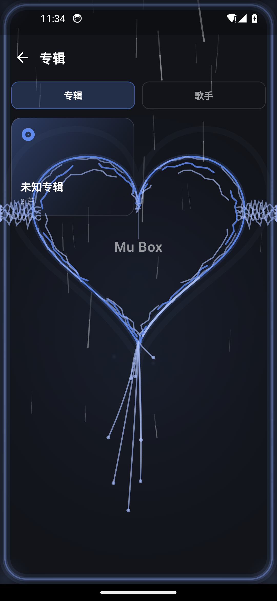

# Mu Box 手机版

一个 **Android 本地音乐播放器**，用 Flutter 写。曲库、歌单、歌词、封面、音效、主题全部在
设备本地完成 —— 发布版**不申请 `INTERNET` 权限**，没有任何联网功能。

- 语言：Dart / Kotlin
- 平台：Android
- 许可证：**GPL-3.0**（见 [许可证](#许可证)）

---

## 下载

**[⬇ dist/mubox-1.0.0-arm64.apk](dist/mubox-1.0.0-arm64.apk)** · 20,299,099 字节 · Android 7.0+ · arm64

```
SHA-256  66FBD158438C23A477D60FFF28BCD6CC1531594DBD722188B815DDAF8A67F587
签名证书  82:BF:D9:1C:97:3F:62:77:DF:4C:1C:35:36:21:D0:77:0F:98:A3:84:69:F6:36:B8:57:83:56:0E:73:8A:26:6A
```

> 点开链接后按页面右上角的 **Download** 按钮即可。装之前建议核对一下 sha256
> （Windows：`certutil -hashfile mubox-1.0.0-arm64.apk SHA256`；Linux/macOS：`sha256sum`）。
> 安装包直接放进仓库是因为发布这台机器所在的网络传不了 Release 附件，**内容与正式发布版完全一致**。

---

## 目录

- [下载](#下载)
- [这是什么](#这是什么)
- [功能亮点](#功能亮点)
- [截图](#截图)
- [环境要求](#环境要求)
- [怎么构建](#怎么构建)
- [怎么安装](#怎么安装)
- [常见问题](#常见问题)
- [许可证](#许可证)
- [打赏](#打赏)

---

## 这是什么

把手机里的音乐**复制一份到 App 私有目录**，之后就以这份内部副本播放：

- 原始文件被删除、存储卡被拔出、权限被回收，音乐库照样能播；
- 不会因为外部目录变动而「丢歌」「丢歌单」。

播放界面之上做了三件互相独立的事：**原生音效链**（均衡器 / 低音 / 响度，挂在播放器自己的
audio session 上）、**真实频谱**（原生 `Visualizer` 采样，驱动六种律动动画）、
**背景特效层**（视觉 / 氛围 / 边框三区，几十种可调参数）。这三样共用同一条 session 归属规则，
换播放器时会跟着改绑。

设计上刻意「**功能内联**」：特效、主题色、字体逻辑都在仓库自己的代码里，不依赖任何外部素材
目录，也不在运行时下载任何东西。

## 功能亮点

### 曲库

- **扫描导入**：扫描系统媒体库，把歌曲复制进 App 内部目录
- **歌单管理**：新建 / 删除 / 拖拽排序 / 批量增删移 / 多选；可给单曲改显示名
- **专辑 · 歌手**：按标签分组浏览，未知标签归「未知专辑 / 未知歌手」
- **拼音排序**：按汉字拼音首字母排序（内置定长表，无运行时依赖）
- **私密区域**：把歌设为私密，列表、搜索、导出、备份里都不出现；进入需用**系统锁屏密码**验证

### 播放

- 列表循环 / 单曲循环 / 随机三种模式；队列内可单独勾选「参与循环」
- 0.5x ~ 2x 倍速
- **A-B 片段循环**：打 A 点 / 打 B 点 / 清除，三态一键循环
- **交叉淡变**：曲末与下一首重叠淡入淡出，并配合队列预取（可关；手点「下一首」仍是硬切）
- **音量淡变**：起播与切歌淡入、暂停淡出，消掉切换那一下的爆音（可关）
- 进度条松手才 seek；通知栏 / 锁屏 / 车机支持 ±15 秒快进快退
- **睡眠定时**：15 / 30 / 45 / 60 分钟倒计时，到点淡出后暂停
- **会话恢复**：重启回到上次的队列、曲目与进度

### 后台与系统集成

- `audio_service` 媒体会话：通知栏卡片、锁屏控制、耳机线控 / 蓝牙媒体按键
- 耳机拔出（becomingNoisy）立即暂停
- 可请求忽略电池优化，减少国产 ROM 在锁屏 / 切后台时把播放掐掉

### 音效

- **均衡器**：段数与增益范围由设备决定（常见 5 段），可直接拖曲线，支持设备自带预设；
  只在用户启用过之后才在播放时附着，没开过零开销
- **音效增强**：低音增强（强度可调）+ 响度增强（上限 +12 dB），两者各自独立附着，
  老设备只认其中一个也不会互相拖死
- 曲线下叠 **37 柱实时频谱**

### 频谱与特效

- **真实频谱**：原生 `Visualizer` 挂在**自己这个播放器**的 audio session 上，
  频谱 / 波形 / 环形 / 圆点 / 音浪 / 镜像六种律动
- **背景氛围**：雨滴 / 星空 / 阳光 / 彩星 / 萤火虫 / 极光 / 飘雪 / 气泡
- **视觉特效**：爱心（含「牵手」串联）/ 旋转方块 / 粒子漩涡 / 能量光球 / 粒子聚散 / 万花筒等，
  支持**同一特效开多层**、每层独立调参
- 边框特效；三者互斥关系与省电策略在实现里统一管理，锁屏 / 退后台自动停动画

### 外观

- **40 套内置主题色** + 自定义取色（HEX / RGB / CMYK 三种输入都认）
- 4 档字体缩放；可加载自定义字体文件
- **壁纸**：原图存储、透明度可调、毛玻璃面板
- 每个特效都能单独选颜色（跟随主题 / 内置色 / 自定义色）

### 歌词与封面

- 同目录 `.lrc` 解析 + 内置歌词编辑器；每行可挂一行**译文子行**
- **歌词校准**：以当前对齐为基准一档档相对挪、反复累积，正偏移 = 歌词延后
- 歌曲图标：从相册选图 → 正方形裁剪页（拖动 / 双指缩放），列表与播放栏都跟着换

### 数据安全

- **一键备份**：把歌单、设置、内部音乐副本、歌词、封面、壁纸、特效方案打包成 zip，
  导出到手机的 `Documents/MuBox/`
- **从备份恢复**；恢复前先把旧设置落盘成回滚点，中途失败会回滚
- 导出全部歌曲到公共 `Music/MuBox`（导出走系统 MediaStore，同名文件先比大小与 sha256，
  一致就跳过、不一致才原地覆写）

---

## 截图

| 曲库 | 专辑 / 歌手 |
|---|---|
|  |  |

> 截图取自 Android 14 模拟器上的 `1.0.0` 发布包（截图里的曲目是测试音频，不是任何人的真实曲库）。

---

## 环境要求

| 项 | 要求 |
|---|---|
| Flutter | stable 通道，**≥ 3.44**（`pubspec.yaml` 要求 Dart SDK `^3.12.2`） |
| JDK | **17**（`android/app/build.gradle.kts` 里 `sourceCompatibility/targetCompatibility`） |
| Android SDK | **compileSdk 37**；`minSdk` / `targetSdk` 跟随 Flutter SDK 的默认值（`flutter.minSdkVersion` / `flutter.targetSdkVersion`） |
| Android NDK | 用 Flutter 指定的版本（`flutter.ndkVersion`），一般由 `flutter build` 自动提示安装 |
| 设备 | arm64 真机（默认只打 `android-arm64`） |

> 两个本地插件补丁（`third_party/`）决定了主包 `on_audio_query` 与 `audioplayers`
> **只能精确锁定版本**，不要改成 `^` —— 原因见[依赖升级指引](UPGRADE_NOTES.md)。

## 怎么构建

```bash
flutter pub get
flutter build apk --release
```

产物在 `build/app/outputs/flutter-apk/app-release.apk`。

常用变体：

```bash
# 只打 arm64（体积最小，发布用）
flutter build apk --release --target-platform android-arm64 --tree-shake-icons

# 顺便让模拟器（x86_64 镜像）能装：保留 x86_64 的引擎 so
flutter build apk --release --target-platform android-x64 -PcompatTest=true
```

仓库里还有两个一键脚本，会**在打完包后核对包里的通知栏图标资源**，缺一个就非 0 退出并拦住安装：

```powershell
# Windows（PowerShell 5.1 亦可）
powershell -NoProfile -ExecutionPolicy Bypass -File .\build_release.ps1
```

```bash
# Git Bash / Linux / macOS
./build_release.sh
```

### 签名

默认走 **debug 签名**（只适合本地调试）。要出正式包：

```bash
cp android/key.properties.example android/key.properties
```

然后按模板里的说明填入自己的 keystore 路径与口令（`android/keystore/` 与
`android/key.properties` 都已 gitignore，不会入库）。生成 keystore 的方法写在模板注释里。

> ⚠️ `android/key.properties` 存在时才会切换成正式签名；**一旦换签名，覆盖安装就会失败**
> （`INSTALL_FAILED_UPDATE_INCOMPATIBLE`），只能卸载重装，App 私有数据会一起清掉。

## 怎么安装

```bash
adb install -r build/app/outputs/flutter-apk/app-release.apk
```

或者把 APK 拷到手机上点开安装（需要允许「安装未知来源应用」）。

> 覆盖安装请在**同一签名**下进行。⛔ 不要用 `flutter install`：它会**先卸载再安装**，
> App 私有数据（歌单、内部音乐副本、歌词、封面、壁纸）会被一起清空。
> 换签名 / 换机前，先在 App 内「设置 → 数据备份」导出一份 zip。

---

## 常见问题

**Q：频谱 / 律动完全不动？**
A：Android 12+ 的原生 `Visualizer` 采样输出混音，系统把它按「录音」对待，需要
**麦克风（`RECORD_AUDIO`）**权限。装完 App 在首启引导页里授权，或到系统设置 → 应用 → Mu Box →
权限里打开「麦克风」。部分 ROM 会把这项设成 AppOps `ignore`，此时要用系统设置界面
重新授权才生效；实在不行重启一次 App。

**Q：切后台 / 锁屏一会儿音乐就停了？**
A：到系统设置里允许 Mu Box **后台运行**，并选择「**不限制**电池用量 / 允许后台活动」。
App 内也提供了「请求忽略电池优化」的入口（设置 → 播放）。

**Q：把歌从手机里删掉了，App 里还能播吗？**
A：能。扫描导入时会把歌**复制进 App 私有目录**，之后播的是那份内部副本。反过来，内部副本
会占用存储空间；不想要的歌在 App 里删除即可。

**Q：想换回原文件或者把歌给别人？**
A：用「导出全部歌曲到手机」，会复制到公共 `Music/MuBox/`。

**Q：覆盖安装报 `INSTALL_FAILED_UPDATE_INCOMPATIBLE`？**
A：新旧包签名不一致（换过 keystore、或之前装的是别的签名版本）。这种情况物理上无法覆盖安装，
只能：App 内导出备份 → 卸载 → 装新版 → 从备份恢复。

**Q：升级报 `INSTALL_FAILED_VERSION_DOWNGRADE`？**
A：要装的包 `versionCode` 比已装的低。把 `pubspec.yaml` 的 `version:` 里 `+` 后面的数字调大再打。

**Q：构建失败，报找不到 `namespace` 或 JVM target 不一致？**
A：`third_party/` 里的两个插件补丁就是为这个存在的，先确认：
① `pubspec.yaml` 的 `dependency_overrides` 两个路径还在；
② `on_audio_query` / `audioplayers` 的版本没被放开成 `^`；
③ 补丁内容与[依赖升级指引](UPGRADE_NOTES.md)一致。

**Q：Release 包通知栏没有按钮 / 播放会被系统静音？**
A：release 构建默认开 `shrinkResources`，AGP 只扫 dex、扫不到 Dart 字符串里的资源名，
通知栏那几个 drawable 会被删掉。仓库里已经用
`android/app/src/main/res/raw/keep.xml` 的 `tools:keep` 钉住了；如果你自己加了新的
「只在 Dart 字符串里出现」的资源，记得一并加进去，或构建时加 `-Pshrink=false`。

**Q：App 会联网吗？**
A：发布版**不申请 `INTERNET` 权限**，全部功能离线可用。
（`debug` / `profile` 构建里声明了 `INTERNET` —— 那是 Flutter 工具链做热重载与断点调试需要的。）

---

## 许可证

本项目以 **GNU General Public License v3.0（GPL-3.0）** 发布，全文见根目录 [`LICENSE`](LICENSE)。

你可以自由地使用、修改、再分发，但**再分发（含修改后的版本）必须同样以 GPL-3.0 开源**，
并保留版权与许可证声明。本程序**不提供任何担保**。

### 第三方组件

`third_party/` 下有两个**上游插件的修改版**（vendored fork），各自保留上游许可证；
每个目录里都有 `NOTICE.md` 逐条写明「相对上游改了哪些文件、每一处改了什么」：

| 目录 | 上游 | 版本 | 许可证 |
|---|---|---|---|
| `third_party/audioplayers_android` | [bluefireteam/audioplayers](https://github.com/bluefireteam/audioplayers) | 5.3.0 | MIT |
| `third_party/on_audio_query_android` | [LucJosin/on_audio_query](https://github.com/LucJosin/on_audio_query) | 1.1.0 | BSD 3-Clause |

其余依赖（`audio_service`、`shared_preferences`、`permission_handler`、`archive`、
`file_picker`、`share_plus`、`path_provider`、`image_picker` 等）按其各自许可证分发。

---

## 打赏

如果这个项目对你有帮助，可以请作者喝杯咖啡 —— **完全自愿，不影响任何功能**。

<p align="center">
  
  &nbsp;&nbsp;&nbsp;&nbsp;
  
</p>

<p align="center"><sub>左：支付宝　·　右：微信支付（扫码即可，不用加好友）</sub></p>
